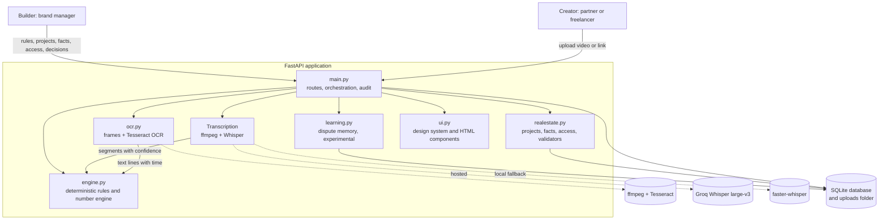
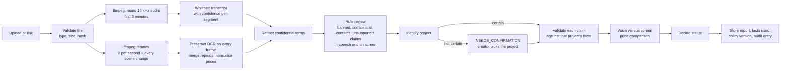
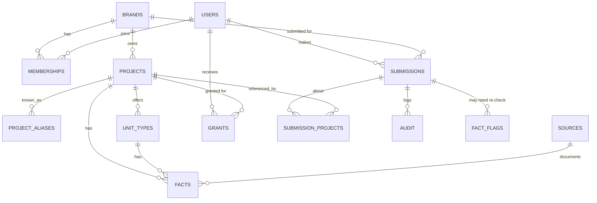

# BrandGuard

**A brand-governance platform that reviews marketing content before it is published.**

BrandGuard listens to a video in Marathi, Hindi or English, **reads every frame of the video for text shown on screen**, checks every price and claim (spoken and written) against a builder's approved facts and brand rules, explains each finding in plain language, and sends anything it is unsure about to a person. Nothing is approved without either a full automated pass or a recorded human decision.

Repository: https://github.com/anuraggavit24/brandguard

---

## Table of contents

1. [The problem](#1-the-problem)
2. [What BrandGuard does](#2-what-brandguard-does)
3. [Architecture](#3-architecture)
4. [The review pipeline, step by step](#4-the-review-pipeline-step-by-step)
5. [The decision rules](#5-the-decision-rules)
6. [Data model](#6-data-model)
7. [The domain layer: projects, facts and access](#7-the-domain-layer-projects-facts-and-access)
8. [The number engine](#8-the-number-engine)
9. [Explainability](#9-explainability)
10. [Security, privacy and human control](#10-security-privacy-and-human-control)
11. [Features by role](#11-features-by-role)
12. [Importing a brand guide](#12-importing-a-brand-guide)
13. [Running locally](#13-running-locally)
14. [Deploying to Render](#14-deploying-to-render)
15. [Configuration reference](#15-configuration-reference)
16. [Testing](#16-testing)
17. [Demo files for judges](#17-demo-files-for-judges)
18. [Repository layout](#18-repository-layout)
19. [Known limitations](#19-known-limitations)

---

## 1. The problem

A large real-estate developer such as Lodha runs many projects in many cities, sold through many channel partners, agencies and freelancers. Each project has its own unit types, prices, carpet and built-up areas, bathrooms, possession dates, RERA registration and offers. Creators post videos for these projects every day, and the prices and offers often appear as text on screen as well as in the voice-over.

Three things go wrong at that scale:

- **Wrong facts.** A partner says "1 crore 50 lakh" for a flat that is approved at 1 crore 90 lakh. Or quotes an offer that expired last month.
- **Wrong project.** A video is about one project but quotes another project's prices.
- **Voice and screen disagree.** The voice-over says one price while the price card on screen shows another.
- **Banned or confidential language.** "Guaranteed returns", "price will double", or an internal term like "dealer commission" slips into a public video, either spoken or drawn on screen.

Manual review does not scale, and a purely automated approver is unsafe, because speech recognition makes mistakes and a wrong approval has legal consequences. BrandGuard sits between the two: it automates what can be verified, and escalates what cannot.

## 2. What BrandGuard does

| Need | How BrandGuard handles it |
|---|---|
| Multi-project, multi-city catalogue | A builder owns many projects. Each project has its own unit types and dated facts. |
| Know which project a video is about | A project identification step with explicit states (matched, likely, ambiguous, not found, conflict, confirmed). It never guesses silently. |
| Read the screen as well as the voice | The video is split into frames and every frame is read with OCR, so text that flashes on screen is not missed. Spoken and on-screen prices are compared. |
| Verify claims | Price, booking amount, area (carpet vs built-up), bathrooms, possession, RERA, offers and distances are each compared with the approved fact of the identified project. |
| Banned and confidential language | Brand rules are checked in the audio transcript, in the text read from the screen and in post captions. Confidential terms are redacted from stored transcripts. |
| Explain every result | Each finding shows where it was said, what was detected, why it matters and what to change. |
| Human in the loop | Uncertain items go to a Review Queue. Creators can dispute a rejection, and the builder resolves it. |
| Audit and proof | Every action is logged. Every approved file has an approval ID and a SHA-256 fingerprint that can be verified later. |
| Access control | Partners and freelancers only see and submit for projects the builder has granted them. Enforced in the backend. |
| Rules from a document | A builder uploads a brand guide PDF and BrandGuard imports rules, projects and prices after the builder confirms them. |

## 3. Architecture

BrandGuard is a single FastAPI application with server-rendered HTML and an embedded SQLite database. It is deliberately simple: one process, no build step, no front-end framework, easy to run and to audit.



### Layers

| File | Responsibility | Why it is separate |
|---|---|---|
| `main.py` | HTTP routes, session roles, upload handling, transcription call, orchestration of a review, audit log, all pages. | The only place that touches the request, the database and the file system together. |
| `ocr.py` | On-screen text: cuts the video into frames, reads every frame with Tesseract, merges repeated and half-typed lines, normalises prices (`1,30,00,000` becomes `1.3 cr`). Fail-safe: if OCR is off or breaks, the review continues as speech-only and says so. | Isolated so a slow or missing OCR can never break the core review. |
| `engine.py` | Pure functions: text normalisation, number parsing for English, Hindi and Marathi, price classification, banned-phrase and confidential-term checks, contact checks. No database. | Pure and deterministic, so it can be tested without a server (`python engine.py --selftest`). |
| `realestate.py` | The real-estate domain: projects, aliases, unit types, dated facts, access grants, project identification, claim validators, reuse checks. | Keeps business rules out of the web layer. |
| `learning.py` | Dispute memory: remembers builder-overturned price disputes. **Experimental, see limitations.** | Isolated so it can be switched off without touching the core review. |
| `ui.py` | Design tokens, icons, the app shell, tables, dialogs, badges. No business logic and no database. | Presentation only. |
| `brandguard.py` | Command-line tool that extracts audio and frames from a video. | The original ingestion prototype. The web app supersedes it. |

### Why this design

- **The language model is used for one thing only: speech recognition.** Every decision is made by deterministic code reading approved facts. That is what makes results explainable and repeatable. The same input always gives the same verdict.
- **Uncertainty is a first-class output.** The system distinguishes a confirmed violation from "I could not verify this", and it never turns the second into approval.
- **Facts are versioned, not overwritten.** A price change closes the old fact and opens a new one, so past approvals can still be traced to the exact fact they used.

## 4. The review pipeline, step by step



1. **Validate.** The file type must be one of `.mp4 .mov .mkv .webm .m4a .mp3 .wav .aac .ogg`, up to 60 MB. A SHA-256 hash is computed while saving. An identical file already submitted for the same brand is flagged as a duplicate.
2. **Audio and frames.** `ffmpeg` converts to 16 kHz mono and keeps the first 3 minutes. For a video file, `ffmpeg` also cuts frames (see 4.1).
3. **Transcription.** Groq's hosted `whisper-large-v3` returns segments with confidence. The brand's glossary (project names, key terms) is passed as a vocabulary hint so names are spelled correctly. A local `faster-whisper` model is available as a fallback (`TRANSCRIBE_MODE=local`).
4. **Redaction.** Confidential terms are replaced in the stored transcript.
5. **Rule review.** Banned phrases and confidential terms are matched in the transcript, in the text read from the screen, and in the post title or description. Phone numbers and emails not on the approved contact list are sent to a person. Comparative and urgency claims such as "lowest price", "best price", "limited units" or "hurry" (and Hindi equivalents) are flagged as needing supporting evidence.
6. **Project identification.** The transcript, the on-screen text and the caption are matched against project names and aliases (official name, short name, Hindi and Marathi spellings) among the projects the submitter is allowed to use.
7. **Claim validation.** Each spoken, on-screen or written claim is checked against the facts of its own project and unit type. Then the prices spoken in the video are compared with the prices shown on screen; if they differ, a person is asked to look.
8. **Decision.** See the next section.
9. **Persist.** The redacted inputs, the full report, the facts used (with their version), the policy version and an audit entry are stored. Confirming the project later re-runs the analysis from the stored redacted inputs, with no second upload.

### 4.1 How on-screen text is read

The aim is that no text on screen can slip past. The method is brute-force on purpose.

1. **Split into frames.** The first 3 minutes are cut into frames at a fixed **2 per second**, and `ffmpeg` also saves an extra frame at **every scene change**. A price card that flashes for a fraction of a second between two regular frames is still captured. In testing, a wrong price shown for 0.3 seconds was caught.
2. **Read every frame.** Each frame goes through Tesseract OCR. No frame is skipped because it "looks similar" to the one before, because a small change such as a different price on an otherwise identical frame is exactly what must not be missed.
3. **Clean the result.** Low-confidence words and non-text noise are dropped. Text that animates in produces partial lines ("DEMO HE", "DEMO HEIGHTS"); the fullest version of each line is kept with the earliest time it appeared. A line that differs in any other way, for example another price, is always kept.
4. **Normalise prices.** `Rs 1,30,00,000`, `₹1.3Cr` and `95 L` are turned into forms the number engine understands (`1.3 cr`, `95 lakh`), so on-screen prices go through exactly the same validators as spoken prices.
5. **Check.** The text goes through banned-phrase, confidential-term and unsupported-claim rules, project identification, and the price, area, bathroom, possession, RERA and offer validators. Findings are marked with their source (`screen`) and the time they appeared.
6. **Voice versus screen.** The set of prices spoken is compared with the set shown. If both exist and share no price, a `VOICE_SCREEN_MISMATCH` finding sends the video to a person.
7. **Time budget.** On a small server, reading every frame can take a long time. OCR stops after `OCR_BUDGET` seconds. If it did not finish, the report is marked **partial** and a `SCREEN_PARTIAL` finding sends it to a person. A partially read video is never auto-approved.
8. **Fail-safe.** If OCR is switched off (`OCR_ENABLED=0`), Tesseract is not installed, or the file has no video, the review continues as speech-only and the report states "On-screen text: not analysed".

Audio-only files and links skip this step. A link submission is checked from its audio and its title and description only.

## 5. The decision rules

Every submission ends in exactly one status.

| Status | Meaning |
|---|---|
| `AUTO_APPROVED` | Identity is certain, at least one claim was verified, and there is no violation and no open question. An approval ID is issued. |
| `REJECTED` | At least one confirmed violation, such as a banned phrase or a price that does not match. The creator can fix and resubmit, or dispute. |
| `BLOCKED` | Confidential company information was mentioned. Cannot be approved. |
| `SUPERVISION` | BrandGuard could not be sure about something. A person decides. This is explicitly not a violation. |
| `NEEDS_CONFIRMATION` | The project could not be identified with certainty. The creator picks the project and the review re-runs. No prices are checked against a guess. |
| `DISPUTED` | The creator challenged a rejection. A builder must overturn or uphold it. |
| `APPROVED` | A builder approved it, including by overturning a dispute. |
| `REJECTED_FINAL` | A builder upheld the rejection. |

**Auto-approval is deliberately hard to reach.** It requires all of the following:

- project identity is `MATCHED`, `MULTIPLE` or `CONFIRMED`
- at least one claim is `VERIFIED`
- zero violations
- zero items waiting for a person

A video with no verifiable claim is never auto-approved. It goes to supervision with the message "nothing could be verified". A video with no detectable speech never passes. A video whose on-screen text could only be partly read never passes either.

Two findings come from the screen check and always need a person: `VOICE_SCREEN_MISMATCH` (spoken and on-screen prices differ) and `SCREEN_PARTIAL` (not every frame could be read in the time allowed). A banned phrase or a wrong price drawn on screen is a normal violation, the same as if it were spoken.

**Claim verdicts:** `VERIFIED`, `VIOLATION`, `UNVERIFIABLE` (no approved fact exists to compare with), `REVIEW` (a person must listen), `INCOMPLETE`, `NA`. A check that was not performed is never counted as passed.

**Project identification states:** `MATCHED`, `LIKELY`, `AMBIGUOUS`, `MULTIPLE`, `NOT_FOUND`, `CONFLICT` (selected project differs from the one in the content), `SELECTED` (only the creator's selection was available), `CONFIRMED`, `NOT_AUTHORIZED`.

## 6. Data model

SQLite, created and migrated automatically at start-up.



| Table | Purpose |
|---|---|
| `users`, `memberships` | Demo identities and which brands each belongs to. A freelancer can belong to several brands. |
| `brands` | A company. Holds its rules registry (banned phrases, confidential terms, approved contacts, speech glossary). |
| `projects` | A named project with city, locality, RERA number and RERA verification level. |
| `project_aliases` | Other names for a project: short names, Hindi and Marathi spellings, common mis-hearings. |
| `unit_types` | Apartment, penthouse, villa, bungalow, row house or plot, with BHK where it applies. |
| `facts` | Versioned, dated facts: price, booking amount, carpet, built-up and plot area, bathrooms, balconies, parking, possession, ready to move, offers, landmark distances. Each has a source, `valid_from`, `valid_to`, an author and a reason for change. |
| `sources` | The document a fact came from (price sheet, brand guide, registry). |
| `grants` | Which user may use which project, with start, expiry and revocation. |
| `submissions` | A submission with its status, verdict, full JSON report (including the redacted transcript and the text read from the screen), approval ID, file hash and dispute note. |
| `submission_projects` | Which project(s) a submission was matched to and how (evidence, who confirmed). |
| `fact_flags` | When a fact used by an approved submission is later changed or withdrawn, the submission is flagged for re-check. History is not rewritten. |
| `audit` | Append-only log of who did what and when. |
| `dispute_cases` | Builder-overturned price disputes (experimental). |

## 7. The domain layer: projects, facts and access

### Hierarchy

```
Brand (the developer)
 └── Project (e.g. Demo Heights, Pune, Wakad, RERA P000...)
      ├── aliases (Hindi, Marathi, short names)
      ├── project-wide facts (possession, ready to move, booking amount, offers)
      └── unit types
           └── facts (price, carpet area, built-up area, bathrooms, balconies, parking)
```

### Dated, versioned facts

A fact is never edited in place. Saving a new price closes the current version the day before and opens a new one. Two things follow:

- Every report stores exactly which fact versions it used (`facts_used`), so an approval can always be traced.
- When a fact used by an earlier approval changes, that approval is **flagged for re-check** instead of being silently altered or silently left stale. The "reuse check" on a submission page tells a creator whether the facts behind an approval are still current.

### Per-project validators

| Claim | Rule |
|---|---|
| Price | Compared with the price of the named unit type (for example "2 BHK"). A price that matches a different unit's price is reported as such. |
| Booking amount | Compared with the project's booking amount. |
| Area | Carpet and built-up are distinguished. Saying "720 sq ft" is checked against the right one. |
| Bathrooms | Compared with the unit type's count. |
| Possession and ready to move | Compared with the stored date and flag. "Ready to move" for a project that is under construction is a violation. |
| RERA | Format is checked (`P` followed by 11 digits). The verification level is shown honestly: format only, registry match, or authoritative. BrandGuard never claims a number is registered unless the builder recorded an official-register check. |
| Offers | Must have an end date. An expired offer is never treated as current. |
| Distance | Compared with the stored travel time to the landmark. |

### Access control

Access is granted per user and per project, with optional expiry, and can be revoked at any time with immediate effect. It is enforced in the backend (`authorized_projects`, `can_use_project`), not by hiding buttons. A project promoted in a video that the creator cannot use produces an "unauthorized project" finding. A new project is invisible to every partner until the builder grants access.

## 8. The number engine

Spoken prices are the highest-risk content, so the number handling lives in its own tested module (`engine.py`).

- Understands numbers spoken in English, Hindi and Marathi, in words or digits, including colloquial forms such as *dedh* (1.5), *sava* (1.25), *saade* (plus half), *paune* (minus a quarter) and tens words.
- Understands lakh and crore, with Indian digit grouping.
- Reads **compound amounts** such as "1 crore 30 lakh" as ₹1.30 Cr. An earlier version read this as two separate amounts and checked only "1 crore", which produced a false rejection. This was fixed and covered by tests.
- Classifies a price against the approved prices:
  - **match** when it is within 0.5 percent of an approved price
  - **unit error** when it is off by a power of ten (lakh versus crore, a dropped zero) within 2 percent. This is reported as a probable transcription or unit mistake and sent to a person, not rejected
  - **mismatch** when it is within 30 percent of an approved price but different, and recognition confidence is good. This is a violation
  - **low confidence** when it is close but the audio confidence is low. Sent to a person
  - **not close to any approved price** is sent to a person, unless the speaker named a unit (for example "3 BHK") and recognition confidence is good, in which case it is a violation against that unit's approved price

Run `python engine.py --selftest` to execute the built-in checks.

## 9. Explainability

Every result can be explained without reading code.

- **Findings.** Each shows *where* (the second in the video, whether it was spoken or shown on screen, or the caption), *what was detected*, *why it matters* and *what to do*. Uncertainties say plainly that they are not confirmed violations.
- **Claim-by-claim table.** Every claim, the project it was matched to, what was said, the approved value and the fact version, the source document and the result.
- **Project identification card.** The evidence for why this project was chosen.
- **Text read from the screen.** A card lists every distinct line OCR found, with the time it first appeared and its recognition confidence, so a reviewer can see exactly what the system saw.
- **"What was and was not checked."** For example, "On-screen text" shows how many frames were read, "Voice versus screen" shows whether prices were compared, and a RERA number is shown as "registry match only" unless an official check was recorded. Logos, colours and fonts are not analysed and are not claimed. The policy version (`policy-2026.10-r2`) is shown on every report.
- **Transcript with confidence.** Low-confidence segments are highlighted so a reviewer knows where speech recognition may have erred.
- **History.** A timeline of every event on the submission.

## 10. Security, privacy and human control

- **Confidential material.** Confidential terms are redacted from the stored transcript and from the stored on-screen text, and mentioning one blocks approval.
- **No secrets in the repository.** The Groq key and the session secret come from environment variables. `.env` and key files are git-ignored.
- **Backend authorisation.** Every project and company check is made on the server. Submissions are scoped to the brand and, for creators, to their own user.
- **Input limits.** Allowed file types, a size limit, a duration limit, and a hash for every file. Uploaded PDFs are limited to 10 MB and 40 pages.
- **Tamper evidence.** Each approved file has a SHA-256 fingerprint. **Verify a File** lets anyone check whether a file is byte-identical to an approved submission before posting it.
- **Human control.** The system only ever approves on a complete, verified pass. Uncertainty always goes to a person. Creators can dispute, and a builder has the final word.
- **Audit trail.** Append-only, includes rule changes, fact changes, access grants, imports and decisions.
- **Safe imports.** A brand guide is never applied silently. The builder reviews and confirms every item, and an uploaded payload is re-validated on the server.

## 11. Features by role

**Creator (channel partner or freelancer)**
- Submit a video by file upload (or by link in a local run)
- See a clear decision with reasons and fixes
- Fix and resubmit, or raise a dispute
- Switch between companies (a freelancer can work for several)
- Confirm the project when the system is unsure
- Verify that a file is the approved one

**Builder (brand manager)**
- Overview dashboard and Review Queue for supervision items and disputes
- Brand Rules: banned phrases, confidential terms, approved contacts, speech glossary
- Projects and Facts: projects, unit types, prices, areas, bathrooms, possession, RERA, offers, travel times, aliases
- Project Access: grant and revoke per project with optional expiry
- Import rules, projects and prices from a PDF
- Disputes: overturn or uphold, with a reason
- Approval Records and Audit Trail
- Compliance insights: the most common findings and the share of disputes overturned, which point at unclear guidelines

## 12. Importing a brand guide

From **Brand Rules**, click **Import from PDF** and upload a PDF or TXT.

The parser is deliberately rule-based, not AI. It reads only recognised structure, so it cannot invent a rule or a price.

```
Banned phrases
- guaranteed returns
- price will double

Confidential terms
- dealer commission

Approved contacts:
9999999999

Glossary:
Demo Heights; Demo Greens Villas

Project: Demo Lakeview
City: Pune
Locality: Baner
RERA: P44444444444
Possession: June 2029
Ready to move: No
Booking amount: 6 lakh
Other names: Lakeview; Lake View
2 BHK Apartment: Price 1.05 Cr; Carpet 640 sq ft; Built-up 790 sq ft; Bathrooms 2; Balconies 2; Parking 1
```

A preview screen then shows every rule, project, unit and price, with each price spelled back ("reads as ₹1.05 Cr") so a lakh versus crore mistake is visible. Lines it did not understand are listed, not dropped. Items already present are skipped, and unchanged values create no new version. Nothing is saved until the builder confirms.

Scanned image PDFs are refused with a clear message. Each property type must be on one line, not in a table.

## 13. Running locally

Requirements: Python 3.11 or newer, `ffmpeg` (which includes `ffprobe`) on the PATH, **Tesseract OCR** for on-screen text, and a free Groq API key for speech recognition.

Install Tesseract once: Windows, the UB Mannheim installer (BrandGuard also finds it in `C:\Program Files\Tesseract-OCR` if it is not on the PATH, or set `TESSERACT_CMD`); macOS, `brew install tesseract`; Ubuntu or Debian, `sudo apt install tesseract-ocr`. Without it everything still works, but on-screen text is reported as "not analysed".

```bash
git clone https://github.com/anuraggavit24/brandguard.git
cd brandguard
python -m venv .venv
# Windows: .venv\Scripts\activate      macOS/Linux: source .venv/bin/activate
pip install -r requirements.txt

export GROQ_API_KEY=your_key_here        # Windows PowerShell: $env:GROQ_API_KEY="your_key_here"
python -m uvicorn main:app --port 8000
```

Open http://localhost:8000. On Windows, `start_brandguard.bat` does all of this, including creating the environment and asking for the key once.

You can check OCR on its own with `python -c "import ocr; r=ocr.read_screen('clip.mp4'); print(r['frames'], [l['raw'] for l in r['lines']])"`. Without a Groq key the site still opens, but speech review will not work. To run fully offline, install `faster-whisper` and set `TRANSCRIBE_MODE=local`.

## 14. Deploying to Render

The repository includes a `Dockerfile` (Python 3.11 slim plus `ffmpeg` and `tesseract-ocr`).

1. Create a new **Web Service** from the repository, runtime **Docker**.
2. Set environment variables: `GROQ_API_KEY`, `SECRET_KEY` (any long random string), `LINKS_ENABLED=0`. On the free plan also set `OCR_FPS=1`, `OCR_WORKERS=1` and `OCR_BUDGET=60` (see the free-tier note).
3. Deploy. The service listens on the `PORT` Render provides. `/health` returns `{"ok": true}`. `/ocr-status` reports whether OCR is available on the server.

**Free-tier note.** Render's free plan has an ephemeral disk that resets on every redeploy and when the service wakes from sleep. BrandGuard re-creates its schema and re-seeds the fictional demo data on every start, so the built-in demo always works. Anything created at run time (new projects, imports, submissions) is lost on reset. A production deployment should use a persistent database.

**Free-tier speed.** The free plan has a fraction of a CPU core and about 512 MB of memory. Speech recognition is hosted (Groq), but frame extraction and OCR run on the server itself, so a short video can take a few minutes and the first request after a quiet period is slower while the server wakes up. The Submit page and the Demo Files page say so. Keep test videos under about 15 seconds. On a normal server, or a paid Render instance, the same review takes seconds.

## 15. Configuration reference

| Variable | Default | Meaning |
|---|---|---|
| `GROQ_API_KEY` | none | Key for hosted speech recognition. |
| `TRANSCRIBE_MODE` | `groq` | `groq` for the hosted model, `local` for `faster-whisper`. |
| `LOCAL_MODEL` | `medium` | Local model size when `TRANSCRIBE_MODE=local`. |
| `SECRET_KEY` | dev value | Signs the session cookie. **Set this in production.** |
| `DATA_DIR` | `data` | Where the SQLite database and uploads are stored. |
| `OCR_ENABLED` | `1` | `0` switches on-screen text reading off. The review then runs speech-only and says so. |
| `OCR_FPS` | `2` | Regular frames per second read from the video. Lower on slow servers. |
| `OCR_SCENE` | `0.01` | Scene-change sensitivity for the extra frames (lower means more frames). |
| `OCR_MAX_FRAMES` | `400` | Upper limit on frames read per video. |
| `OCR_WORKERS` | `3` | Frames read in parallel. Use `1` on a small server. |
| `OCR_BUDGET` | `75` | Seconds after which OCR stops and the report is marked partial. |
| `OCR_LANGS` | `eng` | Tesseract languages, for example `eng+hin+mar` if those packs are installed. |
| `TESSERACT_CMD` | auto | Full path to Tesseract if it is not found automatically. |
| `LINKS_ENABLED` | `1` | `0` hides the paste-a-link form. Link download uses `yt-dlp` and only works from a local machine, not from a cloud IP. |
| `PORT` | 8000 locally, 10000 in Docker | Port to listen on. |

## 16. Testing

```bash
python engine.py --selftest      # number engine and classification
python test_brandguard.py        # end-to-end workflow checks
```

The on-screen pipeline was tested on generated slide videos and on a real sample video: a price card shown for 0.3 seconds between two identical slides is caught; a banned phrase shown only on screen is flagged; a spoken price that differs from the on-screen price raises `VOICE_SCREEN_MISMATCH`; and with OCR switched off the review falls back to speech-only.

`test_brandguard.py` starts the app against a temporary database, replaces speech recognition with scripted transcripts, and drives the real HTTP routes. It covers, among other things:

- identification of the right project from names, aliases and Hindi spellings
- price checks against the correct unit type, including a wrong price for a named BHK
- area, bathroom, possession, RERA and offer validation, including expired offers
- ambiguous and unknown projects going to confirmation, never to a guess
- access control: no access, revoked access and cross-company access
- auto-approval only on a fully verified pass
- fact versioning and re-check flags on earlier approvals
- migration of an older database

## 17. Demo files for judges

The **Demo Files** page (`/test-audio`, in the sidebar and on the home page) needs no sign-in. It has four ready-made files, each with the words spoken, the steps to follow and the result to expect. They are for demonstration only; the company, projects and prices are fictional.

| # | File | What it shows |
|---|---|---|
| 1 | Approval test | Price, carpet area, bathrooms and possession all match. Auto-approved with an approval ID. |
| 2 | Rejection test | Banned phrases ("guaranteed returns", "price will double"), each with the exact second and a fix. |
| 3 | Dispute test | A wrong 3 BHK price is rejected; the creator disputes it and the builder overturns or upholds it. |
| 4 | On-screen text (OCR) test video | A short property video whose details appear as text on screen. The result page shows the "Text read from the screen" card and the voice-versus-screen check. |

An optional sample brand guide (PDF) can be imported under Brand Rules, to try rule and project import. On the free server a review can take a few minutes, as the page explains.

## 18. Repository layout

```
brandguard/
├── main.py              Routes, orchestration, transcription, audit, all pages
├── engine.py            Deterministic rules and number engine (pure functions)
├── ocr.py               On-screen text: frames, Tesseract OCR, merge and normalise
├── realestate.py        Projects, facts, access, identification and validators
├── learning.py          Dispute memory (experimental)
├── ui.py                Design system and HTML components
├── brandguard.py        Command-line video ingestion prototype
├── test_brandguard.py   End-to-end checks
├── sample_registry.json Example brand rules
├── demo_audio/          Demo recordings and video (served on the Demo Files page), sample brand guide
├── Dockerfile           Render deployment (ffmpeg + Tesseract)
├── requirements.txt
└── start_brandguard.bat One-click local start on Windows
```

## 19. Known limitations

These are stated plainly so nobody is misled by the demo.

- **Demo login.** The three roles are not real accounts. There are no passwords. A production version needs real authentication (single sign-on).
- **Data does not persist on the free host.** See the deployment section.
- **Text, not pictures.** BrandGuard reads speech and on-screen text. It does not yet judge logos, colours, fonts, layout, image content, music, or finished posters and banners. The report says so under "What was and was not checked".
- **OCR accuracy depends on the video.** Small, low-contrast, stylised or fast-moving text can be misread (for example "MONEY" read as "MENEY") or missed. English is read by default; Hindi and Marathi on screen need the Tesseract language packs. Spoken prices remain the primary check, and the on-screen text is an extra witness.
- **Voice versus screen compares prices only** at this stage, not other facts such as possession dates.
- **OCR is slow on the free host.** Every frame is read on a very small CPU, so a short video takes minutes. If time runs out the report is marked partial and goes to a person. Links and audio-only files are not read for on-screen text.
- **RERA is not looked up online.** Only the format is validated, and a builder can record a manual check against the official register. State registers have no stable public API.
- **Brand guide import needs the documented format.** A free-form brochure with tables or images will not parse, and scanned PDFs are refused.
- **Dispute memory is experimental.** Overturned price disputes are recorded and listed under Learned Cases. Using them to turn a repeat rejection into a human check is not yet reliable and is not part of the demonstrated workflow.
- **Link ingestion** works only from a local machine.
- **Single process, SQLite.** Fine for a demo and a pilot. A production deployment would use a managed database and a job queue for transcription.

---

*All companies, projects, prices and contacts in this repository are fictional demo data.*
