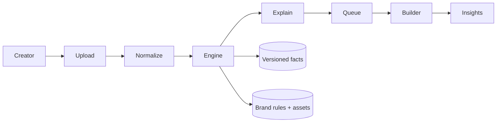

# BrandGuard — Solution

**What we build:** a pre-publication brand-governance platform that checks creator content against approved guidelines, facts and brand assets, explains every issue, suggests compliant fixes, and routes uncertainty to humans — never silent auto-approval of doubtful content.

---

## 1. Product solution (how BrandGuard solves the problem)

Growing organisations publish through employees, agencies, freelancers and AI tools. Mistakes (wrong prices, banned claims, off-brand tone, inaccessible posters, confidential leaks) ship before anyone notices. BrandGuard sits **before publish**:

1. **Ingest** any common format — video/audio, poster/image, PDF/Word/TXT, blog/page URL, or pasted marketing copy.
2. **Normalize** into the same review surface (spoken segments + text lines with time/source), so one rules engine covers all formats.
3. **Analyze** with deterministic checks against the company’s own rules and versioned facts (prices, offers, custom product facts, banned/confidential language, preferred terminology, tone-to-avoid, contacts, logo/palette/contrast on images).
4. **Explain & suggest** — every finding says *where*, *what*, *why*, and *what to change*; optional AI or rule-based rewrites keep the creator’s intent without inventing new numbers or banned claims.
5. **Human review** — uncertain items go to a Review Queue; creators dispute; builders/managers overturn or uphold with an audit trail and optional “lessons” so the same harmless context is not re-flagged forever.
6. **Approve / prove** — only a fully verified pass auto-approves; otherwise a person decides. Approvals carry an ID and SHA-256 fingerprint for later verification.
7. **Insights** — repeated finding types, dispute overturn rates and wording patterns surface where guidelines are unclear or training is needed.

The product is intentionally **automation for what can be proven + humans for what cannot**, with explainability as a first-class output (not a black-box score).

---

## 2. Why this design

| Design choice | Why |
|---|---|
| **Deterministic core + optional AI** | Speech-to-text and optional paraphrase/tone AI help coverage; **decisions** come from code + approved facts. Same input → same verdict. Judges and compliance officers can audit. |
| **Uncertainty is a status, not a pass** | `SUPERVISION` / `NEEDS_CONFIRMATION` never become silent approvals. Wrong auto-approval has legal cost. |
| **Explain + suggest, don’t just reject** | Creators need a path to fix without losing their message. Suggestions are advice only; rewrites are re-validated in code. |
| **Multi-format, one pipeline** | Agencies ship video, posters, captions and blogs. One engine avoids format-specific “shadow rules.” |
| **Versioned facts + audit** | Approvals stay tied to the fact versions used; later price changes flag re-check instead of rewriting history. |
| **Confidential redaction** | Confidential terms are stripped from stored transcripts/OCR text; mentioning them blocks approval. |
| **Simple ops (FastAPI + SQLite)** | Hackathon- and pilot-friendly: one process, no frontend build, easy to run, demo and audit. |

---

## 3. Core flow

```text
Ingest (file / link / page / paste)
    → extract speech (Whisper) and/or text (OCR / document / HTML)
    → redact confidential terms
    → rules + fact validators + asset/a11y checks (+ optional AI review)
    → explain findings + suggested wording
    → status: AUTO_APPROVED | REJECTED | BLOCKED | SUPERVISION | NEEDS_CONFIRMATION
    → human queue / dispute / decide
    → approval ID + hash (when approved)
    → insights from repeated findings & overturned disputes
```

Roles:

- **Creator** (partner / freelancer / agency): submit, see fixes, confirm project, dispute.
- **Builder / manager**: rules, facts, access, queue decisions, insights, lessons.
- **System**: never claims visual fonts or unverified RERA registry lookups; reports what was and was not checked.

---

## 4. Architecture (as implemented in this repo)

Single **FastAPI** app with server-rendered HTML (`ui.py`) and **SQLite**.

| Module | Role |
|---|---|
| `main.py` | Routes, sessions, upload/orchestration, statuses, pages |
| `engine.py` | Pure rules + multilingual amount parsing |
| `realestate.py` / `generic.py` | Projects/products, versioned facts, claim validation |
| `ocr.py` / `formats.py` | Frames, posters, documents, public pages |
| `assets.py` | Logo/palette on images; colour words, logo-name, fonts/visual don’ts on text/OCR; contrast, ALL CAPS, CTAs, alt text |
| `ai_review.py` / `rewrite.py` / `llm.py` | Optional AI paraphrase/tone + guarded rewrites |
| `learning.py` | Dispute lessons (experimental, builder-controlled) |
| `packs.py` | Industry starter rule packs |
| `accounts.py` | Companies, invites, roles |
| `jobs.py` | Bulk upload queue |

External services (optional for demo): **Groq Whisper** (speech), **Groq chat** (AI review/rewrite). Without keys, deterministic rules still run; speech needs a key or `TRANSCRIBE_MODE=local`. Paste-copy / document / page paths demo the full loop without speech.



---

## 5. How this maps to the problem statement

| Requirement | Approach in BrandGuard |
|---|---|
| Guidelines, facts, assets | Brand Rules, Projects/Facts, logo/palette/contrast settings |
| Tone, terminology, messaging | `avoid_tone`, preferred terminology, unsupported-claim list, AI tone/terminology notes |
| Visual consistency + accessibility | Images: logo, palette, contrast, min text size. Paste/docs/OCR/transcripts: off-brand colour words, logo-name mention, fonts/visual don’ts, ALL CAPS, wall-of-text, colour-only cues, weak CTAs, optional alt text |
| Unsupported promotional claims | Deterministic phrase list + AI advice (non-binding) |
| Explain + suggest corrections | Finding cards + rule/AI/demo rewrites |
| Review & approval workflow | Queue, dispute, overturn/uphold, audit, approvals |
| Multiple content formats | Video, audio, image, PDF/DOCX/TXT, URL, **paste copy** |
| Insights on repeated mistakes / unclear guidelines | Compliance Insights page (finding mix, overturn rate → guideline clarity) |
| Automation + human control | Hard auto-approve bar; supervision & confirmation otherwise |
| Confidentiality | Redaction + `BLOCKED` on confidential hits |
| Reliable / explainable | Deterministic engine, policy version, “what was checked” |

---

## 6. Wow features (demo-ready, offline-safe)

| Feature | What judges see |
|---|---|
| **Brand Risk Radar** | 0–100 pre-flight score with SVG spider chart; each spoke cites concrete findings (claims / tone / facts / visual / a11y / confidentiality). |
| **Suggested wording** | Side-by-side original vs suggested wording. A rule-based suggestion is offered only when it is a clean sentence with nothing else flagged (works without API keys); an AI rewrite is available on request and is checked in code before it is shown. |
| **Claim provenance** | Claim → approved-fact evidence panel on every review (matched / mismatched / unsupported + confidence). |
| **Guideline Health** | On Compliance Insights: cards for rules that look too strict / vague / training hotspots, with evidence counts. |

Planned next (see the roadmap in the product PDF): rule-change simulation before publishing a rule, accuracy benchmark on labelled real clips, managed database and job queue.

## 7. 90-second wow demo

1. Open `/` → **Enter as Partner**.
2. **Submit Content** → **Paste copy** → paste: `Book Demo Heights in Wakad, Pune: 2 BHK at 1.3 crore with guaranteed returns, hurry!`
3. Result: **Rejected** + **Brand Risk Radar** + **Claim provenance** (the price is verified against the approved fact) + **Suggested wording**.
4. Switch demo role → **Builder** → **Compliance Insights** → show **Guideline Health** cards + repeated wording.

## 8. Demo without paid keys

- Paste-copy path needs **no** speech key. Risk Radar, rule-based suggestions, provenance and Guideline Health all run offline.
- Set `GROQ_API_KEY` only for live speech + optional AI rewrite/review.

See `.env.example` and README “Running locally”.
